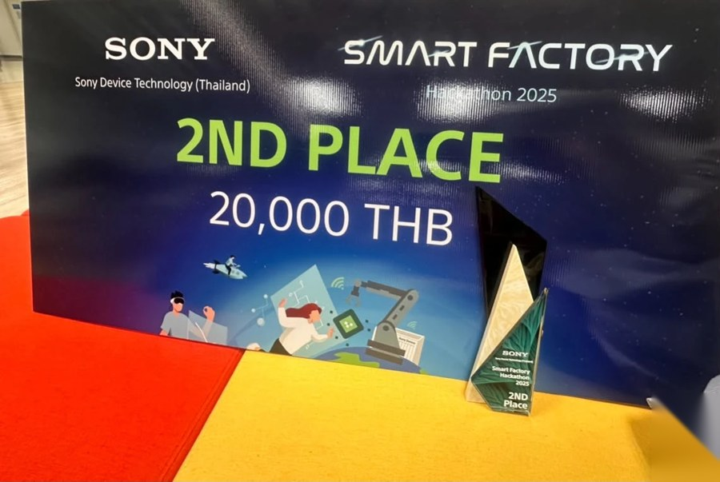
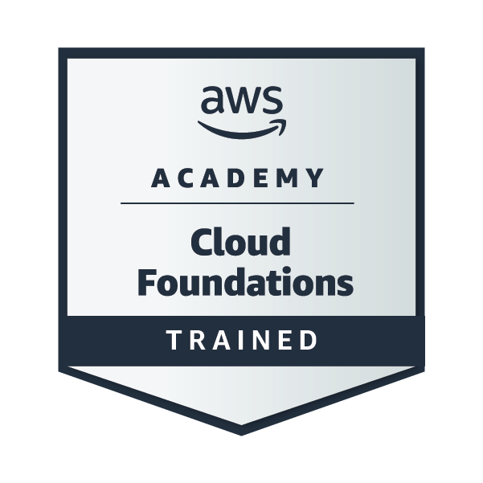
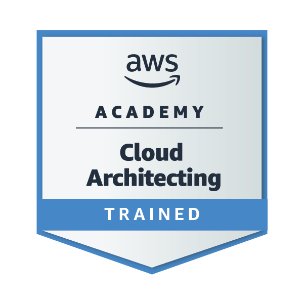
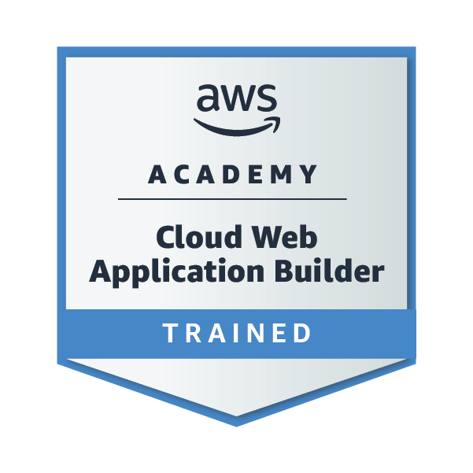

## Hi, I'm Film 👋

CS student at Thammasat University who started in full-stack and drifted toward the infrastructure side: servers, Kubernetes, and making deployments boring.

- ☸️ DevOps researcher at **TonKit Lab**, working on the Virtual Lab platform
- 🛠️ Freelance full-stack & DevOps for small businesses
- 🌱 Looking for a Software Engineering / DevOps internship
- 🥈 2nd place, Sony Smart Factory Hackathon 2025

> 🔒 Most of what I build is freelance client work in private repos, so this page is quieter than my commit history.

### What I've been working on

| Project | What I did | Stack |
|---|---|---|
| [**Virtual Lab**](https://github.com/NawapatThumthaisong97/VirtualLabtest) *TonKit Lab* | • Zero Trust remote access: Ansible-provisioned Cloudflare Tunnel pods on K3s behind NGINX Ingress, with no cluster ports exposed • 4-stage image-scan workflow (Fetch, Validate, Scan, Publish) using Init Containers and a custom reconciler, running Trivy and Skopeo in a read-only, non-root image • Registry sync to AWS ECR with immutable tags and restricted IAM, driven by Ansible and systemd timers | K3s · Ansible · NGINX · Trivy · Skopeo · FastAPI · AWS ECR |
| **The Zins Beauty & Spa** 🔒 *Freelance* | • Internal management system for real-time stock and course tracking across 3 branches • Session auth with HTTP-only, Secure, SameSite cookies and role-based access between Admin and branch staff • GORM-backed database handling concurrent stock deductions; hardened DigitalOcean VPS behind a reverse proxy | React (Vite) · Go Fiber · GORM · DigitalOcean |
| **Ploy Fresh Fruit** 🔒 *Freelance* · [live site](https://ployfreshfruit.com) | • E-commerce and order management with a custom admin dashboard and customizable fruit baskets • LINE Rich Menu for payment-slip approval and real-time delivery tracking • GitHub Actions CI/CD, Docker, and a VPS secured with Nginx and Certbot | Next.js · Express · PostgreSQL · Docker · GitHub Actions |
| **Realmed Store** 🔒 *Freelance* | • Warehouse system for a medical equipment and pharmacy supplier, with full ownership of the backend database design • JWT and Bcrypt auth with HTTP-only, Secure, SameSite cookies • CRUD APIs and an email-based password recovery flow for staff | React · Express · MongoDB |
| [**cloudflare-r2-event-driven-pipeline**](https://github.com/PanupongFilm/cloudflare-r2-event-driven-pipeline) | • Event-driven upload pipeline on Cloudflare R2, Queues and Workers • Decouples the upload trigger from the main backend so instructor requests are handled asynchronously, before workloads are routed to Kubernetes | Go · Cloudflare R2 · Queues · Workers |
| [**Inventory Management LIFF**](https://github.com/PanupongFilm/inventory-management-liff) *Family business* | • LINE Official Account for my family's water shop, with a Rich Menu for adding orders, sales summary, and product and order management • Profit report for any date range; each order snapshots cost, price and promotion at sale time, so past profit stays correct when prices change | Next.js · TypeScript · Prisma · PostgreSQL · LINE LIFF · Rich Menu |

🔒 = private client repo

### Tech I use

### Award

**2nd place, Sony Smart Factory Hackathon 2025** 🥈

Built a real-time manufacturing anomaly dashboard that tracks live machine operations and material waste, using WebSockets with an Express.js and FastAPI backend.

 

### Certifications

  

### Elsewhere

